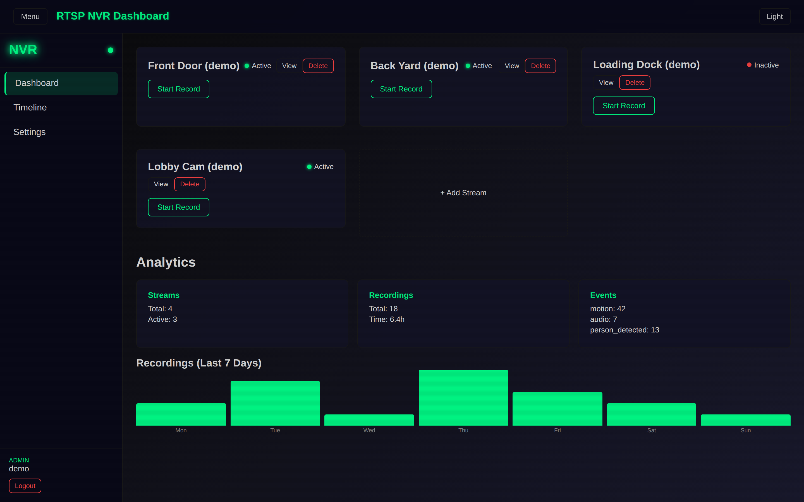
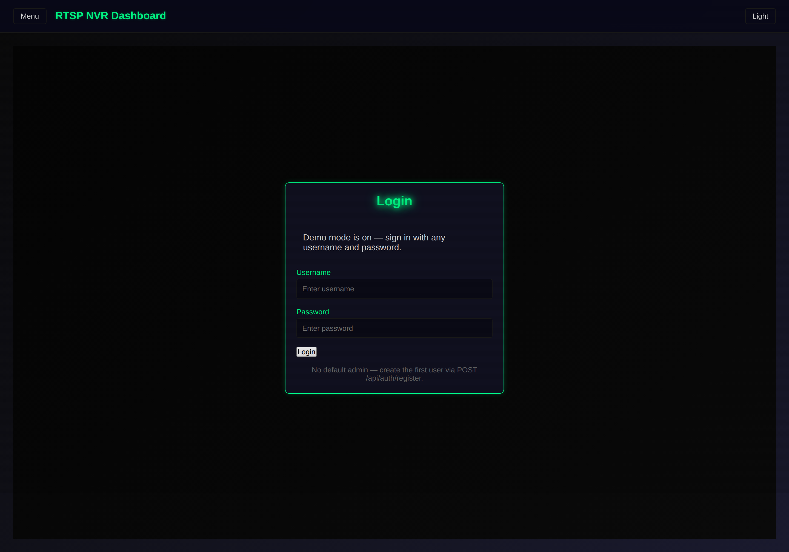

<div align="center">


# vidara

**Self-hosted RTSP NVR dashboard — live camera monitoring, motion recording, and a playback timeline.**
Formerly SentryView.

[](https://github.com/OneByJorah/vidara/releases)
[](https://www.docker.com/)
[](https://www.python.org/downloads/)
[](https://opensource.org/licenses/MIT)

</div>



## What This Is

vidara is a self-hosted network video recorder dashboard for IP cameras. It pairs a React
frontend with a Flask + PostgreSQL + Redis backend and uses FFmpeg for stream handling:
register RTSP camera streams, monitor their status on a cyber-themed dashboard, trigger
recordings, browse events on a timeline, and manage settings behind a JWT-authenticated
login.

## Quick Start (Docker, verified)

```bash
git clone https://github.com/OneByJorah/vidara.git
cd vidara
cp .env.example .env          # defaults work out of the box
docker compose up -d --build
```

Then open **<http://localhost:3000>**. The stack starts in **demo mode** (`DEMO_MODE=1` in
`.env`): sign in with any username and password, and the dashboard shows four fake cameras
(`rtsp://192.0.2.x` — RFC 5737 documentation addresses) with sample analytics. No real
cameras or RTSP streams are contacted.



### Real deployment

1. Edit `.env`: set `POSTGRES_PASSWORD`, `SECRET_KEY`, `JWT_SECRET_KEY`, and `DEMO_MODE=0`.
2. Start the recorder worker too (it is excluded from demo mode):

   ```bash
   docker compose --profile live up -d --build
   ```

   Set `RTSP_URL` in `.env` to a reachable `rtsp://` URL.
3. Create the first admin (there is **no** default account):

   ```bash
   curl -X POST http://localhost:5000/api/auth/register \
        -H 'Content-Type: application/json' \
        -d '{"username": "admin", "password": "change-me-please"}'
   ```

4. Sign in at <http://localhost:3000> with those credentials.

| Service  | Default port           | Notes                         |
| -------- | ---------------------- | ----------------------------- |
| Frontend | `FRONTEND_PORT` (3000) | React SPA served by nginx     |
| Backend  | `BACKEND_PORT` (5000)  | Flask API, `/health` endpoint |
| Postgres | internal 5432          | not published to the host     |
| Redis    | internal 6379          | not published to the host     |
| FFmpeg   | internal 8080          | `--profile live` only         |

## Features

- **Live stream dashboard** — camera tiles with active/inactive status and a WebSocket status dot
- **Recording controls** — start/stop recordings per stream, usage analytics and a 7-day chart
- **Event timeline** — browse motion/audio/detection events with filters
- **JWT auth** — register, login, password change; role-based users (admin/user/viewer)
- **Demo mode** — `DEMO_MODE=1` serves obviously-fake cameras (192.0.2.x) and accepts any login, so you can try the UI risk-free
- **Ops built in** — Postgres health checks, nightly cleanup job, nightly `pg_dump` backup container, non-root containers

## Tech Stack

- **Frontend** — React 18 (CRA), react-router, socket.io-client, nginx
- **Backend** — Python 3.11, Flask, Flask-JWT-Extended, Flask-SocketIO, APScheduler
- **Data** — PostgreSQL 15, Redis 7
- **Media** — FFmpeg worker (`--profile live`)

## Limitations (honest notes)

- The dashboard does not render live video in-browser; streams require HLS transcoding by the
  FFmpeg worker, and the worker currently targets a single `RTSP_URL` rather than per-camera
  streams registered in the UI.
- There is no default admin account; the first user must be created via the register API.
- Demo mode accepts **any** credentials — never run `DEMO_MODE=1` on an exposed host.
- The nightly cleanup/backup jobs are cron-scheduled inside the containers and are not
  currently configurable from the UI.

## Contributing

Contributions are welcome. [Open an issue](https://github.com/OneByJorah/vidara/issues) to report a bug or request a feature.

## License

MIT — see [LICENSE](LICENSE).
